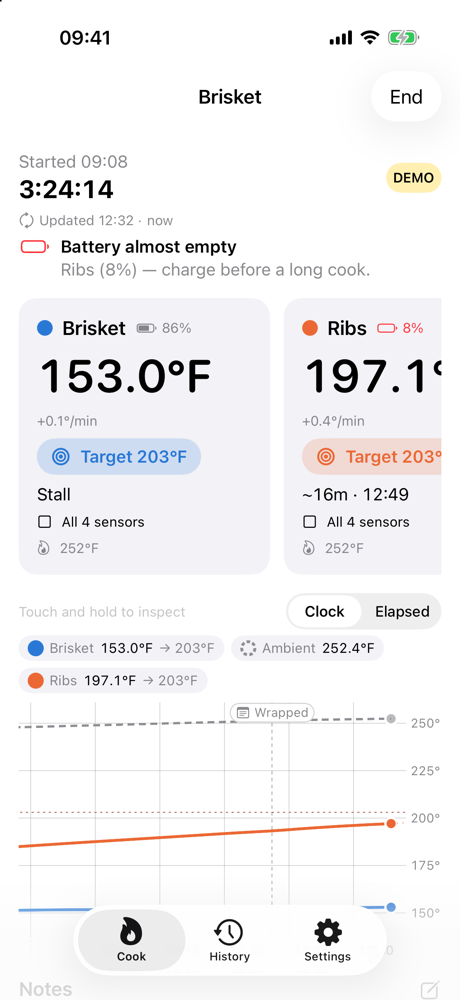
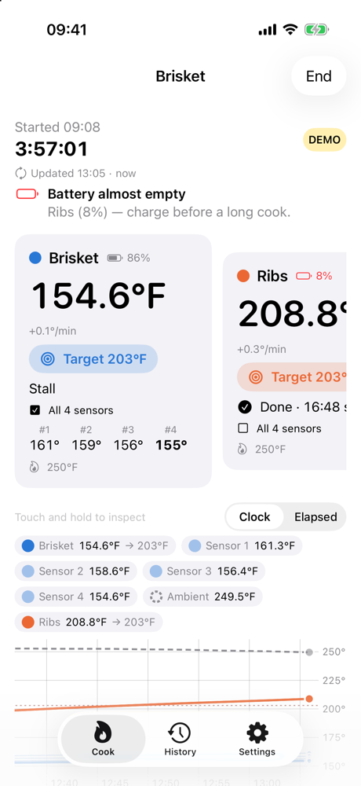
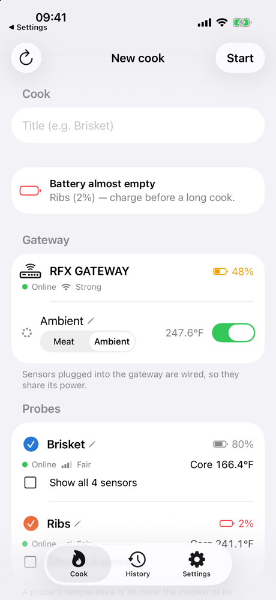
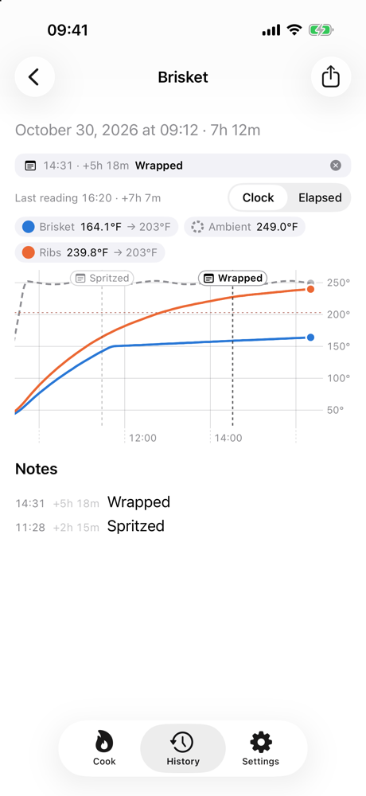
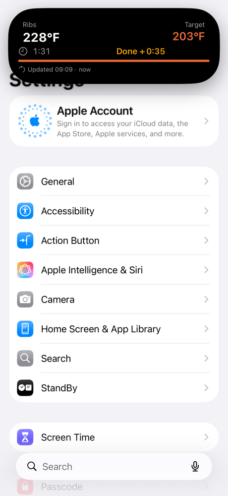
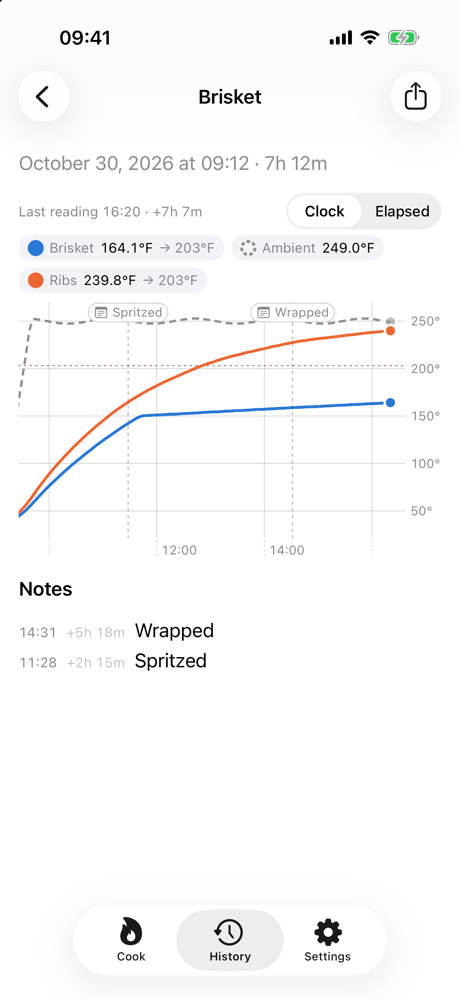

# OpenMEAT

An open-source iOS app for **cooking** with ThermoWorks RFX probes. Set a target in two taps, watch
every probe and the pit on a live, interactive graph, get an honest estimate of when it'll be done,
jot notes as you go, and look back at every cook afterwards. It uses your ThermoWorks Cloud account;
probe setup and configuration stay in the official ThermoWorks app.

> Unofficial — not affiliated with or endorsed by ThermoWorks.

<p align="center">
  
  
  
</p>
<p align="center">
  
  
  
</p>

## Features

- **Built around real RFX hardware.** The gateway (status, Wi-Fi, battery, wired Pro-Series sensors) and each RFX MEAT probe as one probe — its core temperature is the coldest of its four sensors, with an optional "show all sensors" view, before or during a cook.
- **Live, interactive graph.** Every probe and the pit, follow-live, pinch to zoom, drag to pan, touch-and-hold to read exact values, clock or elapsed time, a dot at each line's latest reading, and labeled note markers.
- **Time to target.** A Newton-cooling estimate with an EWMA-smoothed rate constant, stall detection, and a count-up "since target" once it's done.
- **Alerts and Live Activity.** "Almost done" (default 5 minutes before, adjustable) and "target reached" notifications; a Live Activity / Dynamic Island with temperature, elapsed time, ETA countdown and when it last updated.
- **Batteries and connection** for the gateway and every probe before you start, with warnings when one is nearly empty.
- **Notes** with one-tap quick notes ("Wrapped", "Spritzed", …), shown on the graph.
- **History** of every cook with its graph, notes and CSV export.
- **Demo mode** with simulated probes — try it without an account.

See **[docs/SPEC.md](docs/SPEC.md)** for the product and technical spec, including what's known about
the ThermoWorks Cloud data and the limits of background updates on iOS.

## Getting started

Requirements: Xcode 26+, iOS 18+ deployment target, [XcodeGen](https://github.com/yonaskolb/XcodeGen) (`brew install xcodegen`).

```bash
make generate          # project.yml → OpenMEAT.xcodeproj
open OpenMEAT.xcodeproj
```

- **OpenMEAT** scheme: the real app (sign in with ThermoWorks, or tap *Try demo mode*).
- **OpenMEAT Demo** scheme: launches straight into a running simulated cook at 60× speed: a gateway with a wired ambient sensor plus two probes (a brisket that stalls, and ribs with a low battery).

To run on a device, create `Config/Signing.local.xcconfig` (git-ignored) with your team, and a bundle-ID prefix you own if `org.openmeat` is taken for you:

```
DEVELOPMENT_TEAM = ABCDE12345
OM_BUNDLE_ID_PREFIX = com.yourname
```

Then `make device` builds and installs on a connected iPhone (`DEVICE=<udid>` to pick one).

## Layout

| Path | What |
| --- | --- |
| `Packages/OpenMEATKit` | All non-UI code, testable on macOS: `ThermoWorksCloud` (API client), `CookCore` (domain, estimator, persistence), `CookSession` (live polling engine), `ThermoWorksMock` (simulator, mock service, HTTP stubs + fixtures) |
| `OpenMEAT/` | SwiftUI app: auth, live cook, interactive chart, notes, history, settings, notifications, Live Activity controller |
| `OpenMEATWidgets/` | Live Activity / Dynamic Island UI |
| `Shared/` | Code compiled into several targets (activity attributes, accessibility IDs) |
| `OpenMEATTests/`, `OpenMEATUITests/` | App unit tests (Swift Testing) and UI tests (XCUITest, demo mode) |

## Tests

```bash
make test-package      # package unit + hermetic integration tests (macOS, seconds)
make test-app          # app unit + UI tests on the simulator
make test              # everything
make test-live         # optional read-only smoke test against the real cloud
                       #   THERMOWORKS_EMAIL=… THERMOWORKS_PASSWORD=… make test-live
```

Override the simulator with `make test-app SIM="iPhone 17" OS=26.4`.

Demo/test launch arguments: `-OM_MOCK 1 -OM_SCENARIO gatewayAmbient|brisketStall|chickenFast|twoProbesSteak|probeDisconnects|noAmbient -OM_TIME_SCALE 600 -OM_POLL 0.5 -OM_RESET 1 -OM_AUTOSTART 1`.

## License

MIT — see [LICENSE](LICENSE).
